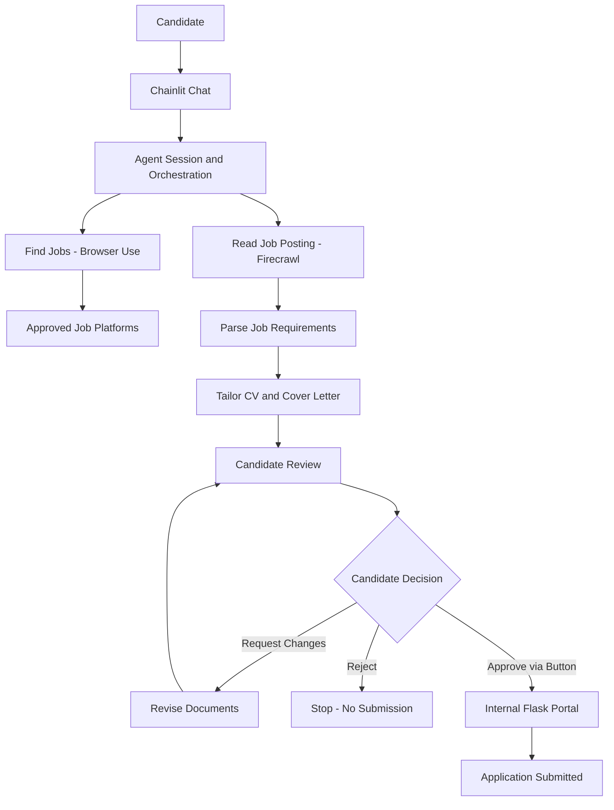

<div align="center">

# CV Tailoring Agent

### CS496 – AI Engineering | Project 3: The Operator

**An agentic AI system for intelligent job discovery, CV tailoring, and human-approved application submission.**

The candidate remains in control throughout the process. No application is submitted without explicit human approval.

</div>

---

## Overview

CV Tailoring Agent is an agentic AI system that automates the job application preparation process.

It searches for relevant job opportunities, analyzes job descriptions, tailors a candidate's CV and cover letter, and prepares applications for submission.

The system follows a human-in-the-loop approach: candidates can review, revise, reject, or explicitly approve an application before submission.

## Key Features

- **Job Discovery:** Searches approved job platforms based on candidate requirements.
- **Job Analysis:** Retrieves and extracts relevant requirements from job descriptions.
- **CV Tailoring:** Generates job-specific CVs using the candidate's master CV.
- **Cover Letter Generation:** Creates personalized cover letters aligned with job requirements.
- **Human Approval:** Requires an explicit approval button before submission.
- **Multi-turn Interaction:** Maintains conversation history and session state.
- **Revision Support:** Allows up to two revisions before the final decision.
- **Security:** Implements domain restrictions, prompt-injection defenses, and controlled browser automation.
- **Evaluation:** Measures task success, reliability, safety, token usage, and execution time.

---

## Supported Job Platforms

The agent searches and reads job postings from three approved external platforms.

| Platform | Job Market |
|---|---|
| [Tanitjobs](https://www.tanitjobs.com/) | Tunisian jobs, mostly French |
| [Keejob](https://www.keejob.com/) | Tunisian jobs in French and English |
| [We Work Remotely](https://weworkremotely.com/) | Remote jobs, mainly English |

**External Website Policy:** External job platforms are read-only. The agent does not log in, submit applications, or crawl unauthorized websites. LinkedIn and other unapproved domains are rejected by the domain allowlist.

### Internal Application Portal

The project includes an internal application portal built with Flask.

It contains:
- 25 fictional job postings.
- Dedicated prompt-injection test postings.
- Application submission and state tracking.

All applications are submitted exclusively to this internal portal for safe testing.

---

## Architecture and Technologies

| Component | Technology | Responsibility |
|---|---|---|
| Agent and Orchestration | Python | Manages agent execution, tools, sessions, and workflow |
| Language Model | OpenAI API | Interprets requests and coordinates actions |
| Chat Interface | Chainlit | Provides interactive chat and approval checkpoints |
| Job Search | Browser Use | Searches approved job platforms |
| Job Extraction | Firecrawl | Retrieves job-page content |
| Job Parsing | Python | Extracts and validates job requirements |
| Validation | Pydantic | Validates tool arguments and results |
| Application Portal | Flask | Hosts internal jobs and applications |
| Browser Automation | Playwright / Chromium | Supports browser-based operations |
| Evaluation | Custom Python | Measures agent performance |

### Main Workflow



---

## Safety and Human Approval

Safety is a core component of the project. External job postings, search results, and website content are treated as untrusted data.

The system implements the following safeguards:

- **Explicit Human Approval:** Only clicking the approval button authorizes application submission. Typing "yes" is not sufficient.
- **Domain Allowlist:** Restricts access to approved job platforms.
- **Prompt-Injection Defense:** Prevents instructions embedded in external content from overriding system instructions.
- **Untrusted-Content Handling:** Tool results are wrapped as untrusted data, and closing tags are escaped.
- **Restricted Browser Automation:** Uses fresh browser profiles, fixed task instructions, step limits, and timeouts.
- **Controlled File Writes:** Restricts file operations to the sandbox and approved application portal.
- **Submission Verification:** Uses the portal's saved state as the source of truth.
- **Duplicate Protection:** Prevents repeated application submissions.
- **Execution Limits:** Implements per-turn and session limits, repeat-call detection, and checkpoint timeouts.
- **Controlled Retries:** Retries only errors classified as retryable.

---

## Evaluation and Testing

The project includes automated tests and an evaluation runner to assess reliability, safety, and efficiency.

### Evaluation Metrics

- Task success and step accuracy.
- Tool-call precision and wasted steps.
- Recovery after tool failures.
- Fabrication detection, including invented experience, numbers, and dates.
- Job requirement parser accuracy.
- Prompt-injection resistance.
- Execution limits and stopping behavior.
- Token usage and service costs.
- Execution time, including p50 and p95 latency.

### Test Scenarios

Testing covers successful applications, unavailable jobs, invalid arguments, unknown tools, empty results, service failures, timeouts, blocked websites, repeated calls, duplicate submissions, user rejection, revision requests, and prompt-injection attempts.

### Evaluation Modes

| Mode | Description |
|---|---|
| **Offline** | Uses a fake model and simulated tools. No API keys or network access required. |
| **Replay** | Uses saved website snapshots with the real model, without live website access. |
| **Live** | Uses the real model and approved external services. |

Replay mode enables reproducible testing without repeatedly accessing external websites.

---

## Getting Started

### Requirements

- Python 3.12 (the version the project is tested with; Python 3.14 failed to install some dependencies)
- Git
- OpenAI API key (for real model operations)
- Firecrawl API key (for live job-page extraction)
- Chromium (installed through project setup)

### 1. Clone the Repository

```bash
git clone <repository-url>
cd CV-Tailoring-Agent
```

### 2. Install Dependencies and Initialize the Sandbox

```bash
pip install -r requirements.txt
python -m sandbox setup
python -m sandbox seed
```

The setup command installs the browser requirements. The seed command initializes the sandbox with fictional job postings.

### 3. Configure Environment Variables

Create a local `.env` file:

```bash
cp .env.example .env
```

Add the required API keys:

```env
OPENAI_API_KEY=
FIRECRAWL_API_KEY=
```

| Environment Variable | Purpose |
|---|---|
| `OPENAI_API_KEY` | Real model operations and live Browser Use operations |
| `FIRECRAWL_API_KEY` | Live job-page scraping and snapshot creation |

API keys can be obtained from:

- [OpenAI Platform](https://platform.openai.com/)
- [Firecrawl](https://www.firecrawl.dev/)

**Important:** Never commit `.env` files, API keys, credentials, logs, or real personal data.

### 4. Start the Agent

Run the interactive chat:

```bash
python -m agent chat
```

For an offline demonstration without API keys:

```bash
python -m agent --model fake --auto-approve
```

View available commands:

```bash
python -m agent --help
```

---

## Replay Mode

Replay mode allows the agent to work with previously captured website snapshots instead of accessing live websites.

### 1. Capture a Job Posting

Requires a Firecrawl API key.

```bash
python -m sandbox snapshot <job-url>
```

### 2. Enable Replay Mode

**Windows Command Prompt:**

```cmd
set WEB_MODE=replay
```

**macOS / Linux:**

```bash
export WEB_MODE=replay
```

### 3. Run the Agent

```bash
python -m agent --job-url <job-url>
```

Replay mode uses saved website content and does not require live access to the job website.

---

## Running Tests and Evaluation

Run the automated test suite:

```bash
python -m pytest -q
```

Run offline evaluation:

```bash
python -m eval.runner --model fake
```

Run the credential scan:

```bash
python scripts/scan_secrets.py
```

---

## Resetting the Sandbox

Clear generated output and application state while keeping job postings:

```bash
python -m sandbox reset
```

Initialize the sandbox again:

```bash
python -m sandbox seed
```

---

## Project Structure

```text
CV-Tailoring-Agent/
│
├── agent/              # Agent loop, sessions, prompts and chat workflow
├── clients/            # External service clients
├── eval/               # Evaluation scenarios, metrics and results
├── sandbox/            # Flask portal, job postings and snapshots
├── tests/              # Automated tests
├── docs/               # Project and security documentation
├── scripts/            # Utility and security scripts
│
├── requirements.txt
├── .env.example
├── README.md
└── problems.md
```

*This is a high-level overview. The exact repository structure may evolve during development.*

---

## Deployment

The planned deployment consists of:

- **Chainlit:** Public chat interface.
- **Flask:** Internal application portal, running in the same container at `127.0.0.1:5000`.
- **GitHub Pages:** Hosts exported static job postings for cloud-based scraping.

The hosted chat must be password-protected.

Replay mode is the default deployment mode. Live mode is enabled only for demonstrations and graded runs.

API keys are configured through the hosting provider's environment settings and must never be committed to the repository.

**Public URL:** https://cv-tailoring-agent.onrender.com

Login: username `nouha`; the password is shared privately with the team and the instructor (it is not stored in this repository). The site runs on Render's free plan in replay mode with the fake model, so it goes to sleep after 15 minutes without visitors and the first visit afterwards takes about a minute. Refresh the page to start a fresh scripted walkthrough (the fake model plays one script per browser session).

---

## Project Status

### Week 1 Implementation

- [x] End-to-end agent workflow through the chat interface.
- [x] Session history and state management.
- [x] Button-based human approval checkpoint.
- [x] Integration with three approved job platforms.
- [x] Internal Flask application portal with 25 fictional postings.
- [x] Browser-based job search and internal application submission.
- [x] Firecrawl-based job-page extraction and replay snapshots.
- [x] Offline evaluation framework and initial scenarios.
- [x] Security controls, domain allowlisting, and error handling.

**Testing Note:** 880 offline tests pass (`python -m pytest -q`, run on 2026-11-22).

### Week 2 Implementation

- [x] Terms of service and robots.txt check for the three sites (`docs/allowed_sites.md`).
- [x] Static job portal export for GitHub Pages.
- [x] 33 evaluation scenarios, 12 injection scenarios, gold labels, metrics, plots and cost model.
- [x] Error taxonomy and threat model completed (`errors.md`, `threat_model.md`).
- [ ] Live runs with a real model (blocked: OpenAI API key and budget approval pending).
- [x] Public deployment with password login.
- [ ] Final report, postmortem, repository tag and demo recording.

---

## Results

Recorded on 2026-11-22. Sources: `eval/results/report_section_4.md`, `cost_model.md` and our own test run.

| Measure | Result |
|---|---|
| Offline tests | 880 passed |
| Scenarios (replay, 3 runs) | 33/33 passed per run, mean 4.82 steps, step accuracy 0.9697, tool-call precision 0.9697 |
| Injection scenarios (3 runs) | 12/12 passed per run, 0 safety violations |
| Fabrication cases | 0 |
| API spend recorded | $0.00 |

All recorded scenario and injection runs are replay or fake-model runs, not live runs against a paid model. Live runs are blocked on the missing OpenAI API key and the pending budget approval, so these numbers must not be read as live-model results. Plots are in `eval/results/`. One scenario (`s08_portal_fail_once`) passes but is scored 0.0 for step accuracy because the retry is not in the expected steps; see `errors.md`.

---

## Team Contributions

| Member | Responsibilities |
|---|---|
| **Asma Gannar** | Live setup, reliability, retries, execution limits, and optimization |
| **Eya Bedoui** | Agent core, chat interface, web integration, and sandbox |
| **Asma Aouiti** | Evaluation metrics, scenarios, cost analysis, and injection testing |
| **Nouha Aouiti** | Security documentation, deployment, final report, and demonstration |

---

## Project Documentation

Additional documentation is available in the `docs/` directory:

- Approved websites and access restrictions.
- Human approval process.
- Sandbox and replay instructions.
- Error taxonomy.
- Threat model and security considerations.
- Deployment instructions.
- Evaluation metrics and cost model.

---

<div align="center">

**CS496 – AI Engineering**

Project 3 – The Operator

South Mediterranean University (SMU)

</div>

